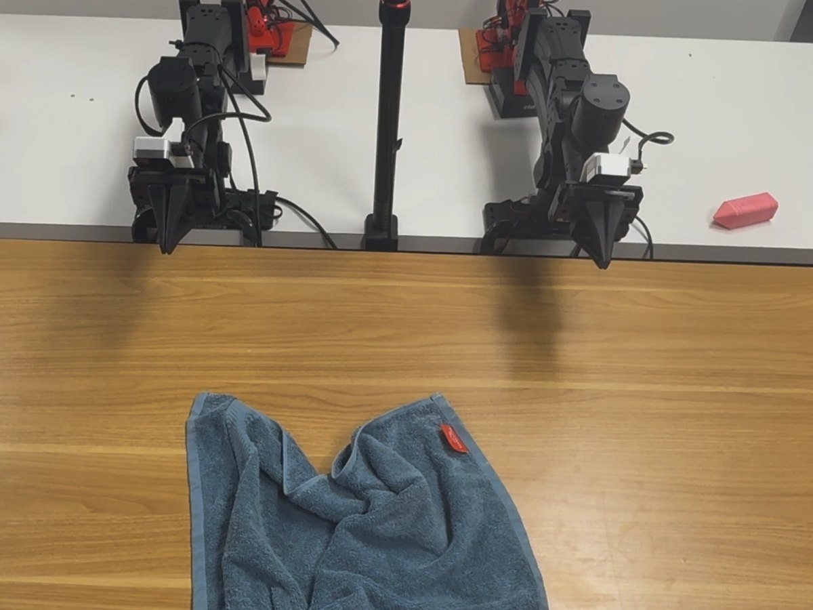
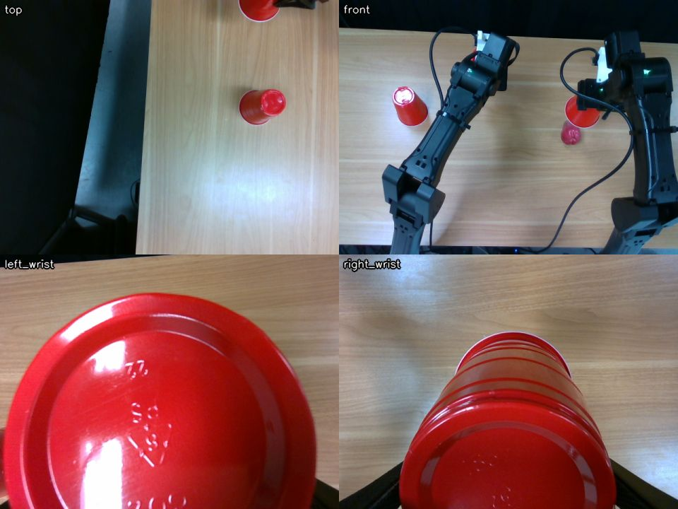

+++
title = "Getting Robot-Use Agents to Run in Real Time"
date = 2026-11-11T00:00:00-08:00
authors = ["Shaoxiong Duan", "Yang Yuanbo", "Junda Chen", "Yulun Wu", "Hao Zhang"]
author = "Shaoxiong Duan, Yang Yuanbo, Junda Chen, Yulun Wu, Hao Zhang"
ShowReadingTime = true
authorOnNewLine = true
draft = false
contentClass = "post-content-justified"
summary = "Robot-use agents score well on benchmarks whose simulators wait for the model, but on a real robot every second of thinking is a second the robot stands still. On a two-arm robot, we cut the agent's per-request overhead, kept its context short and let the robot run queued actions while the model plans the next ones, hiding most of the model's time behind motion."
[cover]
  image = "img/thumbnail.jpg"
  relative = true
  alt = "Two robot arms and a crumpled towel next to the headline result: towel folding about 3x faster, from 18 to 6 minutes"
  hiddenInSingle = true
[socialIcons]
  [[socialIcons.icon]]
    name = "twitter"
    url = "https://twitter.com/haoailab"
+++

<style>
:root{--r-bg:#ffffff;--r-fg:#17191f;--r-muted:#5d6472;--r-faint:#8a909c;--r-rule:#e5e7ec;--r-panel:#f6f7f9;--r-think:#6c5bd4;--r-think-soft:#c9c1f2;--r-tool:#d8902a;--r-tool-soft:#f2d9ae;--r-robot:#1c9a86;--r-robot-soft:#bfe5dd;--r-idle:#eceef2;--r-bad:#d4553f;--r-link:#3c56c9;--r-note-bg:#fff7e6;--r-note-fg:#7a5410}
body.dark{--r-bg:#1d1e20;--r-fg:#e7e9ee;--r-muted:#a3a9b5;--r-faint:#7c8290;--r-rule:#33363d;--r-panel:#25272b;--r-think:#9b8cf0;--r-think-soft:#4a4180;--r-tool:#e8a94a;--r-tool-soft:#6b5228;--r-robot:#3cc0aa;--r-robot-soft:#1f5a50;--r-idle:#2c2f36;--r-bad:#ec7a64;--r-link:#8ea3ff;--r-note-bg:#2e2615;--r-note-fg:#f0cf8a}
.post-content figure.rua-wide,.post-content figure.rua-fig-plain{margin:28px 0 30px}
@media (min-width:1000px){.post-content figure.rua-wide{margin-left:-80px;margin-right:-80px}}
.post-content .rua-fig{border:1px solid var(--r-rule);border-radius:8px;padding:14px;overflow-x:auto;background:var(--r-bg);margin:0}
.post-content .rua-fig svg{display:block;width:100%;height:auto;min-width:560px;margin:0}
.post-content .rua-fig.rua-narrow svg{min-width:0}
.post-content .rua-fig svg text{font-family:inherit;fill:var(--r-fg)}
.post-content .rua-fig svg .sm{font-size:11px;fill:var(--r-muted)}
.post-content .rua-fig svg .xs{font-size:10px;fill:var(--r-faint)}
.post-content .rua-fig svg .lb{font-size:12.5px}
.post-content .rua-fig svg .lbb{font-size:12.5px;font-weight:600}
.post-content .rua-fig svg .mn{font-family:ui-monospace,Menlo,Consolas,monospace;font-size:11px}
.post-content figure figcaption{font-size:.88em;font-weight:400;color:var(--secondary);margin-top:10px;line-height:1.5;text-align:left}
.post-content .rua-legend{display:flex;flex-wrap:wrap;gap:6px 18px;font-size:.82em;color:var(--secondary);margin-top:10px}
.post-content .rua-legend span{display:inline-flex;align-items:center;gap:6px}
.post-content .rua-legend i{width:12px;height:12px;border-radius:2px;display:inline-block}
.post-content .rua-photos{display:grid;grid-template-columns:repeat(2,minmax(0,1fr));gap:12px;align-items:center}
.post-content .rua-photos img{width:100%;height:auto;display:block;border-radius:8px;margin:0}
@media (max-width:560px){.post-content .rua-photos{grid-template-columns:1fr}}
.post-content .rua-tbl{overflow-x:auto;margin:6px 0 10px}
.post-content .rua-tbl td.n,.post-content .rua-tbl th.n{text-align:right}
.post-content .rua-tbl table{font-variant-numeric:tabular-nums}
.post-content video{width:100%;border-radius:8px;display:block}
.post-content .rua-c{opacity:.6}
.post-content .rua-ref{font-size:.9em;margin:0 0 6px}
</style>

**TL;DR**

- Robot-use agents are still far too slow for the real world. Benchmarks like RoboDojo don't show it, because their simulators wait for the model before stepping.
- The agent's time goes mostly to per-request overhead, time to first token (TTFT) above all, which it pays on every tool-call round trip. So we cut the number of requests, kept the context short and made the tools faster.
- We then let the robot carry out queued actions while the model plans the next ones, which hides most of the model's time behind motion.
- Finished towel-folding runs went from a median of about 18 minutes to about 6, and on a cup task the robot moved 84% of the time. What remains is latency: the robot acts on what it saw about 5 seconds earlier.

Over the past year, robot-use agents (RUAs) have become a serious alternative to end-to-end robot policies. GPT-6 Astra, driving a robot through code, scored above all 40 public policies on RoboDojo [[1]](#r1). Uni-robot-agent put open-weight models such as Qwen3.8-Flash-Next on the same benchmark, well ahead of VLA and world-action-model baselines like π0.5 and OpenWAM-α [[2]](#r2). Anthropic reports 64.9% on RoboDojo Sim for Fable 5.2 [[3]](#r3).

On a real robot, though, these agents are slow. In Fable 5.2's launch video the robot solves a puzzle cube [[3]](#r3), but even with the pauses cut out, the solve takes about an hour.

Benchmarks like RoboDojo don't capture this. Their evaluation loop is synchronous: the simulator blocks until the policy returns its next actions, and episodes are limited by the number of steps, not by time [[4]](#r4). In this setting a long TTFT or slow decoding costs nothing. On a real robot the clock keeps running while the model thinks, and the robot sits idle until the next command arrives. Rankings can change once the world stops waiting, too: in a game setting, a stronger but slower model wins when the game pauses for it and falls behind when it doesn't [[5]](#r5).

<figure class="rua-wide">
<div class="rua-fig">
<svg viewBox="0 0 860 210" role="img" aria-label="In simulation the world pauses while the agent thinks; in the real world the robot idles.">
  <text x="0" y="22" class="lbb">Benchmark simulator</text>
  <text x="0" y="40" class="sm">the world waits for the agent</text>
  <g transform="translate(180,12)">
    <rect x="0" y="0" width="70" height="26" rx="3" fill="var(--r-think)"/><text x="35" y="17" text-anchor="middle" class="sm" style="fill:#fff">think</text>
    <rect x="72" y="0" width="60" height="26" rx="3" fill="var(--r-robot)"/><text x="102" y="17" text-anchor="middle" class="sm" style="fill:#fff">act</text>
    <rect x="134" y="0" width="110" height="26" rx="3" fill="var(--r-think)"/><text x="189" y="17" text-anchor="middle" class="sm" style="fill:#fff">think</text>
    <rect x="246" y="0" width="60" height="26" rx="3" fill="var(--r-robot)"/><text x="276" y="17" text-anchor="middle" class="sm" style="fill:#fff">act</text>
    <rect x="308" y="0" width="90" height="26" rx="3" fill="var(--r-think)"/><text x="353" y="17" text-anchor="middle" class="sm" style="fill:#fff">think</text>
    <rect x="400" y="0" width="60" height="26" rx="3" fill="var(--r-robot)"/><text x="430" y="17" text-anchor="middle" class="sm" style="fill:#fff">act</text>
    <line x1="0" y1="40" x2="460" y2="40" stroke="var(--r-rule)"/>
    <text x="0" y="64" class="xs">sim clock</text>
    <rect x="72" y="46" width="60" height="5" fill="var(--r-robot)"/><rect x="246" y="46" width="60" height="5" fill="var(--r-robot)"/><rect x="400" y="46" width="60" height="5" fill="var(--r-robot)"/>
    <text x="480" y="17" class="sm">time that counts:<tspan dx="4" class="lbb" style="font-size:11px">only the acts</tspan></text>
  </g>
  <line x1="0" y1="100" x2="860" y2="100" stroke="var(--r-rule)" stroke-dasharray="3 4"/>
  <text x="0" y="132" class="lbb">Real robot</text>
  <text x="0" y="150" class="sm">the clock never stops</text>
  <g transform="translate(180,122)">
    <rect x="0" y="0" width="70" height="26" rx="3" fill="var(--r-think)"/>
    <rect x="72" y="0" width="60" height="26" rx="3" fill="var(--r-robot)"/>
    <rect x="134" y="0" width="110" height="26" rx="3" fill="var(--r-think)"/>
    <rect x="246" y="0" width="60" height="26" rx="3" fill="var(--r-robot)"/>
    <rect x="308" y="0" width="90" height="26" rx="3" fill="var(--r-think)"/>
    <rect x="400" y="0" width="60" height="26" rx="3" fill="var(--r-robot)"/>
    <line x1="0" y1="40" x2="460" y2="40" stroke="var(--r-rule)"/>
    <text x="0" y="64" class="xs">wall clock</text>
    <rect x="0" y="46" width="460" height="5" fill="var(--r-idle)"/>
    <rect x="0" y="46" width="70" height="5" fill="var(--r-bad)" opacity=".55"/><rect x="134" y="46" width="110" height="5" fill="var(--r-bad)" opacity=".55"/><rect x="308" y="46" width="90" height="5" fill="var(--r-bad)" opacity=".55"/>
    <rect x="72" y="46" width="60" height="5" fill="var(--r-robot)"/><rect x="246" y="46" width="60" height="5" fill="var(--r-robot)"/><rect x="400" y="46" width="60" height="5" fill="var(--r-robot)"/>
    <text x="480" y="17" class="sm">time that counts:<tspan dx="4" class="lbb" style="font-size:11px">all of it</tspan></text>
    <text x="480" y="34" class="sm">the robot idles while the model thinks</text>
  </g>
</svg>
</div>
<figcaption><b>Figure 1.</b> A simulator that waits for the model only counts the actions. On a real robot, every model step is time the robot spends standing still.</figcaption>
</figure>

In this post we describe our first attempts at closing this gap on a real two-arm robot. We didn't change the model. Everything we did was in the harness around it: the tools the agent calls, what goes into its context, and how its actions are scheduled.

## Setup

Our cell has two YAM arms and four cameras: one overhead, one in front and one on each wrist. The agent is GPT-6 Astra running in Codex at its ultrafast service tier and medium reasoning effort. It is given a task description and a Python robot API, with no scripted skills or demonstrations.

<figure class="rua-wide">
<div class="rua-photos">


</div>
<figcaption><b>Figure 2.</b> Our cell. Left: the two YAM arms, with a towel laid out for folding. Right: the four camera views tiled into one image, as the agent receives them.</figcaption>
</figure>

Like PyRUA-Lean [[6]](#r6), we use code as the action interface: the robot is a Python object, and the agent acts by writing short programs against it. We also designed the tools as a white box. The robot API is ordinary Python source that the agent can read, and in practice it starts most tasks by reading it and then writing its own helper functions, such as one that lifts a particular cup. A separate robot server checks every command against a workspace fence and a minimum distance between the arms, which lets the agent run code it wrote itself without anyone reviewing it first.

<figure class="rua-wide">
<div class="rua-fig">
<svg viewBox="0 0 860 230" role="img" aria-label="Harness: model writes code that runs in a persistent Python kernel, which talks to the robot server and the cameras; reports flow back to the model.">
  <defs><marker id="ar" viewBox="0 0 10 10" refX="9" refY="5" markerWidth="7" markerHeight="7" orient="auto-start-reverse"><path d="M0,0 L10,5 L0,10 z" fill="var(--r-muted)"/></marker></defs>
  <rect x="10" y="60" width="170" height="96" rx="6" fill="var(--r-panel)" stroke="var(--r-think)" stroke-width="1.5"/>
  <text x="95" y="98" text-anchor="middle" class="lbb">Model</text>
  <text x="95" y="118" text-anchor="middle" class="sm">coding agent</text>
  <rect x="290" y="40" width="250" height="136" rx="6" fill="var(--r-panel)" stroke="var(--r-tool)" stroke-width="1.5"/>
  <text x="415" y="66" text-anchor="middle" class="lbb">Persistent Python kernel</text>
  <text x="415" y="86" text-anchor="middle" class="sm">readable robot API</text>
  <text x="415" y="102" text-anchor="middle" class="sm">the agent's own helpers and hooks</text>
  <rect x="315" y="114" width="200" height="46" rx="4" fill="var(--r-bg)" stroke="var(--r-rule)"/>
  <text x="415" y="133" text-anchor="middle" class="mn">kernel.queue([a, b, c])</text>
  <text x="415" y="150" text-anchor="middle" class="xs">action queue</text>
  <rect x="650" y="30" width="200" height="70" rx="6" fill="var(--r-panel)" stroke="var(--r-robot)" stroke-width="1.5"/>
  <text x="750" y="58" text-anchor="middle" class="lbb">Robot server</text>
  <text x="750" y="78" text-anchor="middle" class="sm">safety fence, IK, control</text>
  <rect x="650" y="122" width="200" height="70" rx="6" fill="var(--r-panel)" stroke="var(--r-robot)" stroke-width="1.5"/>
  <text x="750" y="150" text-anchor="middle" class="lbb">2 arms, 4 cameras</text>
  <line x1="180" y1="88" x2="288" y2="88" stroke="var(--r-muted)" marker-end="url(#ar)"/>
  <text x="234" y="80" text-anchor="middle" class="xs">code</text>
  <path d="M288,140 L180,140" stroke="var(--r-muted)" marker-end="url(#ar)" fill="none"/>
  <text x="234" y="132" text-anchor="middle" class="xs">results + images</text>
  <text x="234" y="158" text-anchor="middle" class="xs">pushed reports</text>
  <line x1="540" y1="70" x2="648" y2="62" stroke="var(--r-muted)" marker-end="url(#ar)"/>
  <line x1="648" y1="152" x2="540" y2="146" stroke="var(--r-muted)" marker-end="url(#ar)"/>
  <line x1="750" y1="100" x2="750" y2="120" stroke="var(--r-muted)" marker-end="url(#ar)"/>
  <text x="594" y="58" text-anchor="middle" class="xs">commands</text>
  <text x="594" y="164" text-anchor="middle" class="xs">frames, state</text>
</svg>
</div>
<figcaption><b>Figure 3.</b> The harness. The model writes code, a long-lived Python process runs it against the robot, and results, images and reports flow back.</figcaption>
</figure>

## Where the time goes

Our early towel-folding runs on the real robot took between 13 and 37 minutes. Figure 4 profiles one of the longest. The model accounted for 78% of the wall time and tool calls for nearly all the rest. The robot moved for only a quarter of the run, and much of that motion happened inside blocking calls the agent was waiting on.

<figure class="rua-wide">
<div class="rua-fig">
<svg id="f3" viewBox="0 0 860 170" role="img" aria-label="Time breakdown of an early towel run"></svg>
</div>
<figcaption><b>Figure 4.</b> Where the time went in an early towel-folding run. The summary hold is the API holding each response until its reasoning summary was written; we turned summaries off for later runs. TTFT is estimated as model time minus decoding, which includes the hidden reasoning tokens.</figcaption>
</figure>

Very little of the model's time went to producing output. About two thirds of it was TTFT. Measured from the harness, it covers prefill, the network and any other processing on the server; through the API we can't tell how it splits. A response with fewer than 100 output tokens still had a median TTFT of about two seconds, and an agent pays it on every tool-call round trip. Many of these requests did very little: the agent would spend a whole round trip viewing an image, checking on a program it had started, or asking where an arm had ended up. On average it made several requests per robot action, and the robot was idle through all of them.

Agent workloads are input-heavy, especially robot-use agents with their frequent image reads: the context grows with every step, while each output is a short tool call. So TTFT, paid on every request, outweighs decoding. To go faster, we needed the agent to make fewer requests and make each one cheaper, and the requests that remained had to happen while the robot was moving rather than before it.

## 1. Faster decoding

In short timed requests, Astra's ultrafast tier generated tokens about four times faster than the Fast (priority) tier, with the same time to first output. In our towel runs the median model response fell from 2.9 s to 1.9 s, a third shorter. These were different episodes, so the comparison is rough, but it fits the profile above: decoding was the smaller part of each response, and a faster decoder leaves TTFT where it was.

## 2. Fewer round trips

Since every request has a fixed cost, we looked for requests that were predictable, meaning the agent almost always made them after a certain kind of action, and folded them into the action itself. The most common pattern was an action followed by several round trips of looking: polling until the program finished, reading each camera image one at a time, and then asking for the robot's state (Figure 5). None of these involves a decision, so we made the action return all of that information directly.

<figure class="rua-wide">
<div class="rua-fig">
<svg id="f4" viewBox="0 0 860 200" role="img" aria-label="Round trips for one action before and after"></svg>
</div>
<figcaption><b>Figure 5.</b> One action and the look after it (illustrative). Before: the model polls for the result, reads each camera image in its own request, then asks for the robot state. After: all of it comes back in one report.</figcaption>
</figure>

A program that renders images now returns them as part of its tool result, so the model sees them without a separate request. Any program that moves the arms finishes by printing the robot's state: where each arm is, whether the grippers are holding something, and any faults. Error messages say which limit was hit and by how much, so the agent can usually fix the problem on its next try. Checking whether a set of candidate poses is reachable takes one call for the whole list rather than one call per pose.

Instead of polling a running action, the agent now receives a report when the action ends, with the result, the robot's state and a camera view. The agent can also register its own checks, such as a segmentation of the towel, to run after every motion, and their output arrives in the same report.

The same reasoning applies to approval. Early on, the agent often previewed an action with a dry run and looked at the result before running it for real, which costs a full round trip per action. Those previews changed its plan in only about 4 of 99 cases. It works better to let the action run and have the model stop or replace it when the report shows a problem.

## 3. Keep the context short

A robot agent looks at a lot of images, and as they pile up in the context, TTFT grows on every request, even though the earlier context is cached. We handled this in two ways. First, we send the four camera views as a single tiled image instead of four separate ones, which keeps TTFT noticeably lower even at the same resolution (Figure 7). Second, once about 20 images have built up, the harness moves the conversation to a fresh thread in which older images are replaced by short text notes and only the newest few are kept (Figure 6). The first request after a prune can't use the prompt cache, so we prune between turns.

<figure class="rua-wide">
<div class="rua-fig">
<svg viewBox="0 0 860 200" role="img" aria-label="Image pruning: old images become text notes, newest images stay">
  <text x="0" y="30" class="lbb">Before</text>
  <g transform="translate(90,12)">
    <rect x="0" y="0" width="110" height="30" rx="3" fill="var(--r-panel)" stroke="var(--r-rule)"/><text x="55" y="19" text-anchor="middle" class="sm">prompt + API</text>
    <g id="imgs"></g>
  </g>
  <text x="0" y="110" class="lbb">After</text>
  <g transform="translate(90,92)">
    <rect x="0" y="0" width="110" height="30" rx="3" fill="var(--r-panel)" stroke="var(--r-rule)"/><text x="55" y="19" text-anchor="middle" class="sm">prompt + API</text>
    <g id="imgs2"></g>
  </g>
  <text x="90" y="160" class="sm">Turns and text stay. Older images become notes like</text>
  <text x="90" y="178" class="mn" style="fill:var(--r-muted)">[image omitted: views/after-grasp.png]</text>
  <text x="530" y="160" class="sm">The newest images stay as they are.</text>
</svg>
</div>
<div class="rua-legend"><span><i style="background:var(--r-tool-soft)"></i>image</span><span><i style="background:var(--r-idle)"></i>text turn</span><span><i style="background:var(--r-panel);border:1px dashed var(--r-faint)"></i>text note for a removed image</span></div>
<figcaption><b>Figure 6.</b> Pruning old images. Every image still in the context adds to TTFT on every later request, so when about 20 have built up, the harness keeps the text of the conversation and the newest few images, and replaces the rest with short notes naming their files.</figcaption>
</figure>

<figure>
<div class="rua-fig rua-narrow">
<svg id="f5" viewBox="0 0 640 220" role="img" aria-label="TTFT after 45 four-camera looks"></svg>
</div>
<figcaption><b>Figure 7.</b> TTFT after 45 four-camera looks in one conversation. Tiling the four views into one image helps, and a smaller grid helps more.</figcaption>
</figure>

## 4. Faster tools

Once most of the extra requests were gone, the time spent inside tools became noticeable, at 6 to 10% of the run. Most of it sat between a look and the next action, where nothing else could happen. The largest improvement came from running the agent's code in a persistent Python process. Imports are paid for once, Python starts a call in tens of milliseconds instead of a few hundred, and variables and helper functions survive from one call to the next. We also made camera capture faster.

## 5. Pipelining: hiding time behind motion

Even with all of the above, the agent still makes a few requests for each action, and as long as each action blocks, the robot waits through every one of them. The last change was to let the model think while the robot moves.

The agent writes each action as a Python function and adds it to a queue. The robot works through the queue in the background while the model plans what comes next, and the model can change the plan at any point: it can replace everything after a given action, or stop the one that is running.

<pre><code>kernel.queue([lift_left, lift_right])             <span class="rua-c"># run in order, in the background</span>
kernel.queue(new_plan, replace_from="lift_right") <span class="rua-c"># replace the queue's tail while the head runs</span>
kernel.action().stop()                            <span class="rua-c"># stop now; the arms hold</span></code></pre>

The timing of feedback turned out to matter (Figure 8). The report for one action arrives as the next one starts, so the model reads how the last action went while the robot is already busy, and still has time to revise the action after that. If the model finishes its turn while the robot is still moving, the harness sends it a fresh camera view so that it gets started on the next step instead of sitting idle. And because a queued action starts from wherever the previous one left off, the agent writes actions that check their own preconditions, for instance that a cup is still in the gripper before carrying it anywhere.

<figure class="rua-wide">
<div class="rua-fig">
<svg viewBox="0 0 860 250" role="img" aria-label="How the queue overlaps model time with robot motion">
  <defs><marker id="ar2" viewBox="0 0 10 10" refX="9" refY="5" markerWidth="7" markerHeight="7" orient="auto-start-reverse"><path d="M0,0 L10,5 L0,10 z" fill="var(--r-muted)"/></marker></defs>
  <text x="0" y="46" class="lbb">Robot</text>
  <text x="0" y="62" class="xs">runs the queue</text>
  <rect x="110" y="30" width="200" height="34" rx="3" fill="var(--r-robot)"/><text x="210" y="52" text-anchor="middle" class="lbb" style="fill:#fff">action 1</text>
  <rect x="312" y="30" width="230" height="34" rx="3" fill="var(--r-robot)"/><text x="427" y="52" text-anchor="middle" class="lbb" style="fill:#fff">action 2</text>
  <rect x="544" y="30" width="200" height="34" rx="3" fill="var(--r-robot)"/><text x="644" y="52" text-anchor="middle" class="lbb" style="fill:#fff">action 3′</text>
  <text x="0" y="146" class="lbb">Model</text>
  <text x="0" y="162" class="xs">plans ahead</text>
  <rect x="110" y="130" width="120" height="34" rx="3" fill="var(--r-think)"/><text x="170" y="151" text-anchor="middle" class="sm" style="fill:#fff">queue 2 and 3</text>
  <rect x="330" y="130" width="160" height="34" rx="3" fill="var(--r-think)"/><text x="410" y="151" text-anchor="middle" class="sm" style="fill:#fff">read report 1, replace 3</text>
  <rect x="560" y="130" width="140" height="34" rx="3" fill="var(--r-think)"/><text x="630" y="151" text-anchor="middle" class="sm" style="fill:#fff">read report 2, queue 4</text>
  <line x1="312" y1="66" x2="330" y2="128" stroke="var(--r-muted)" marker-end="url(#ar2)"/>
  <text x="300" y="98" text-anchor="end" class="xs">report 1 + camera grid</text>
  <line x1="544" y1="66" x2="560" y2="128" stroke="var(--r-muted)" marker-end="url(#ar2)"/>
  <text x="562" y="98" class="xs">report 2</text>
  <path d="M490,130 C 520,100 540,80 560,66" stroke="var(--r-think)" fill="none" stroke-dasharray="4 3" marker-end="url(#ar2)"/>
  <text x="500" y="112" text-anchor="end" class="xs" style="fill:var(--r-think)">replace_from=3</text>
  <line x1="110" y1="196" x2="760" y2="196" stroke="var(--r-rule)"/>
  <text x="110" y="216" class="sm">The report for action 1 arrives as action 2 starts. The model reads it while the arm moves,</text>
  <text x="110" y="234" class="sm">and can still change action 3 before it begins.</text>
</svg>
</div>
<figcaption><b>Figure 8.</b> How the queue overlaps thinking with motion. Each report lands while the next action is already running, so the model's request time is hidden, as long as it finishes before the queue runs dry.</figcaption>
</figure>

<figure class="rua-wide">
<div class="rua-fig">
<svg id="f6" viewBox="0 0 860 300" role="img" aria-label="Agent and robot lanes for the same work in three harnesses"></svg>
</div>
<div class="rua-legend"><span><i style="background:var(--r-think-soft)"></i>TTFT</span><span><i style="background:var(--r-think)"></i>generating</span><span><i style="background:var(--r-tool)"></i>tool / image read</span><span><i style="background:var(--r-robot)"></i>robot moving</span></div>
<figcaption><b>Figure 9.</b> The same cup task in three harnesses, on one time axis. Top: a vanilla agent loop. Middle: sections 1–4, without the queue. Bottom: with the queue (the real run). Model time barely changes from middle to bottom; most of it now happens while the arm moves. The top two rows are replays of the real run, explained under Results. Excludes the agent's initial reading of the robot API code.</figcaption>
</figure>

Uni-robot-agent [[2]](#r2) uses the same idea. Its tool calls can run in the background, so the model keeps reasoning while the robot executes, and in simulation this cut episode times substantially. Our version differs mainly in how results come back: instead of the agent fetching them, each report is pushed to it as the next action starts, while there is still time to change what comes next.

## Results

We first compare real runs. Figure 10 shows every towel-folding run that finished the task or ran for at least a few minutes, grouped by the three versions of the harness we ran on the robot: the original, one with fewer round trips, a shorter context and faster tools but no queue, and the full harness with the queue. Run times vary a lot, because they depend on how the towel starts out and on the choices the agent makes, and many runs were stopped before the end. Alongside time to finish, we therefore show two measures that don't need a finished run: how much of the time the robot was moving, and how much of the model's time overlapped motion.

Cutting round trips raised the robot's moving share from a median of 29% to 52%, because the robot spent less time waiting between actions. It hid none of the model's time, though, since every action still blocked. The queue is what hid it: the median share of model time that overlapped motion went from almost none to about half. Runs that finished took a median of about 6 minutes with the full harness, against 16 to 18 minutes with the earlier versions.

<figure class="rua-wide">
<div class="rua-fig">
<svg id="f9" viewBox="0 0 860 250" role="img" aria-label="Real towel runs before and after the queue"></svg>
</div>
<figcaption><b>Figure 10.</b> Real towel-folding runs, grouped by harness version. Filled dots finished the task; hollow dots were stopped early. Time to finish counts only finished runs. Vertical bars are medians. Excludes the agent's initial reading of the robot API code.</figcaption>
</figure>

Because real runs vary this much, they can't tell us what each design contributes on its own. For that we took one real run of the cup task, made with the full harness, and replayed it without each design in turn. The replay keeps the same model responses, tool calls and actions in the same order, and adds back the requests each design removes, at the step and tool costs we measured on the robot. Only the last bar in Figure 11 is the real run.

<figure>
<div class="rua-fig rua-narrow">
<svg id="f7" viewBox="0 0 640 300" role="img" aria-label="Wall time per stage"></svg>
</div>
<figcaption><b>Figure 11.</b> Wall time for the same cup task as each design is added. Model requests fall from 164 to 59. The queue removes no model time; it overlaps it with motion. Excludes the agent's initial reading of the robot API code.</figcaption>
</figure>

Together, the changes reduce the wall time of this task from 667 s to 204 s, a 3.3× speedup. Before the queue, almost all of the gain comes from cutting the number of model requests. The queue doesn't reduce the model's time at all, but it moves 137 of the 182 seconds of model time into periods when the robot is moving. From the first motion to the end, the robot goes from moving 24% of the time to 84%.

The table below lists the three runs from our demo videos, all made with the full harness. The last column is the median time from the latest observation the model had received (a report or a camera view) to the moment it queued its next action.

<div class="rua-tbl"><table>
<tr><th>Task (real runs)</th><th class="n">Time to finish</th><th class="n">Actions</th><th class="n">Robot moving*</th><th class="n">Model time hidden</th><th class="n">Observation → action</th></tr>
<tr><td>Three cups hide a pear, a ball and nothing; put the pear under the empty cup</td><td class="n">204 s</td><td class="n">14</td><td class="n">84%</td><td class="n">75%</td><td class="n">5.7 s</td></tr>
<tr><td>Spread a partly folded towel and fold it in half</td><td class="n">143 s</td><td class="n">11</td><td class="n">67%</td><td class="n">49%</td><td class="n">4.7 s</td></tr>
<tr><td>The same, from a crumpled towel</td><td class="n">484 s</td><td class="n">32</td><td class="n">78%</td><td class="n">74%</td><td class="n">6.0 s</td></tr>
</table></div>

<p style="font-size:.85rem;color:var(--r-muted);margin-top:-12px">* From the first motion to the end of the task. Times and videos exclude the agent's initial reading of the robot API code.</p>

<figure>
<video src="img/cups-02-timeline-2.5x.mp4" controls muted playsinline preload="metadata"></video>
<figcaption><b>Video 1.</b> The cup task at 2.5×. Below the cameras: the robot lane (each queued action), the agent lane (violet while the model works, amber for tools) and the queue depth.</figcaption>
</figure>

<figure>
<video src="img/towel-fold-18-timeline-2.5x.mp4" controls muted playsinline preload="metadata"></video>
<figcaption><b>Video 2.</b> Spreading a partly folded towel and folding it in half, at 2.5×.</figcaption>
</figure>

<figure>
<video src="img/towel-fold-23-timeline-3x.mp4" controls muted playsinline preload="metadata"></video>
<figcaption><b>Video 3.</b> The same task from a crumpled towel, at 3×. The first fold comes out crinkled, and the agent lifts it until the cloth hangs taut, then lays it back down.</figcaption>
</figure>

## Limitations

Hiding the model's time behind motion is not the same as making the agent fast. Even when the queue hides nearly all of it, every action is still based on an observation that is about 5 seconds old by the time the action is queued (Figure 12). The robot moves most of the time, but it reacts like a player in a game with very high ping.

<figure class="rua-wide">
<div class="rua-fig">
<svg viewBox="0 0 860 170" role="img" aria-label="Latency from observation to action">
  <defs><marker id="ar3" viewBox="0 0 10 10" refX="9" refY="5" markerWidth="7" markerHeight="7" orient="auto-start-reverse"><path d="M0,0 L10,5 L0,10 z" fill="var(--r-muted)"/></marker></defs>
  <rect x="110" y="40" width="640" height="26" rx="3" fill="var(--r-robot-soft)"/>
  <text x="0" y="58" class="lbb">World</text>
  <text x="430" y="58" text-anchor="middle" class="sm">keeps changing: the towel settles, a held object slips</text>
  <circle cx="130" cy="53" r="6" fill="var(--r-fg)"/>
  <text x="130" y="28" text-anchor="middle" class="sm">observation</text>
  <text x="0" y="112" class="lbb">Model</text>
  <rect x="130" y="96" width="250" height="26" rx="3" fill="var(--r-think-soft)"/><text x="255" y="114" text-anchor="middle" class="sm">TTFT</text>
  <rect x="382" y="96" width="170" height="26" rx="3" fill="var(--r-think)"/><text x="467" y="114" text-anchor="middle" class="sm" style="fill:#fff">reason, write the action</text>
  <rect x="554" y="96" width="30" height="26" rx="3" fill="var(--r-tool)"/>
  <line x1="590" y1="109" x2="680" y2="66" stroke="var(--r-muted)" marker-end="url(#ar3)"/>
  <text x="690" y="96" class="sm">action starts from a</text>
  <text x="690" y="112" class="sm">5-second-old view</text>
  <line x1="130" y1="140" x2="584" y2="140" stroke="var(--r-fg)"/>
  <line x1="130" y1="134" x2="130" y2="146" stroke="var(--r-fg)"/><line x1="584" y1="134" x2="584" y2="146" stroke="var(--r-fg)"/>
  <text x="357" y="162" text-anchor="middle" class="lbb">median 4.7–6.0 s</text>
</svg>
</div>
<figcaption><b>Figure 12.</b> The latency the queue can't hide: from the latest observation the model received to the action it queued in response. Median per run, for the three runs in the table.</figcaption>
</figure>

This is also why the queue helps some tasks much more than others. Lifting three cups in turn can be planned from a single look, so several actions wait in the queue and the robot rarely stops. Cloth needs a look after almost every grasp, so the queue runs one deep, and every few actions the robot waits while the model looks and thinks (Figure 13). Tasks that need fine, live correction are the worst case. In our ring-stacking runs, where the agent had to line a ring up over a peg, the robot was moving only 28 to 36% of the time even with the queue, because each small correction depended on seeing the result of the last one.

<figure class="rua-wide">
<div class="rua-fig">
<svg id="f8" viewBox="0 0 860 190" role="img" aria-label="Towel run lanes with long gaps"></svg>
</div>
<figcaption><b>Figure 13.</b> Part of the crumpled-towel run where the queue didn't help. The robot waits while the agent looks before folding, and again while it re-plans after a sweep went wrong.</figcaption>
</figure>

Closing this gap needs a shorter loop from observation to action. That means lower TTFT and less reasoning on routine steps, but it may also mean splitting the work, so that a faster, smaller model or a reactive controller handles the corrections that can't wait several seconds.

## What's next

Throughout this work we treated Codex and OpenAI's serving as a black box. We could change only what the harness sends and when, and we could not even see how the time before the first output splits between prefill, queueing and the rest of the server. Much of the remaining latency sits on that side. With a model we serve ourselves, the harness and the server can be designed together, and we see many openings there: processing the next camera view while the arm is still moving, before the model is asked about it; dropping old images from the cache without paying for a full prefill; and scheduling a robot's requests so that a correction is not stuck in a queue. We think co-designing serving with the harness can take this a good deal further.

## References


<p id="r1" class="rua-ref">[1] An Unexpected Robot Policy: Early Evaluations of GPT-6 Astra on RoboDojo. <a href="https://arxiv.org/abs/2609.24170">arXiv:2609.24170</a></p>
<p id="r2" class="rua-ref">[2] Democratizing Robot-Use Agents: A Unified Harness with Open Models (uni-robot-agent). <a href="https://arxiv.org/abs/2611.01560">arXiv:2611.01560</a></p>
<p id="r3" class="rua-ref">[3] Anthropic, Claude Fable and Mythos 5.2. <a href="https://www.anthropic.com/news/claude-fable-and-mythos-5-2">anthropic.com</a></p>
<p id="r4" class="rua-ref">[4] RoboDojo. <a href="https://arxiv.org/abs/2607.04434">arXiv:2607.04434</a>; evaluation loop in <a href="https://github.com/robodojo-benchmark/RoboDojo">github.com/robodojo-benchmark/RoboDojo</a> (<code>src/eval_client/eval_env.py</code>).</p>
<p id="r5" class="rua-ref">[5] The World Won't Wait. <a href="https://arxiv.org/abs/2610.20665">arXiv:2610.20665</a></p>
<p id="r6" class="rua-ref">[6] Fewer Tokens, Better Action: GPT-6 Astra Robot Agents with 14% Higher Success Rate but 65% Fewer Tokens (PyRUA-Lean). <a href="https://arxiv.org/abs/2610.01939">arXiv:2610.01939</a></p>

## Acknowledgement

*To be added.*

## Contributors

[Shaoxiong Duan](https://github.com/shaoxiongduan), Yang Yuanbo, [Junda Chen](https://github.com/GindaChen), Yulun Wu, [Hao Zhang](https://haozhang.ai)

## Citation

```bibtex
@misc{realtimerua2026,
  title        = {Getting Robot-Use Agents to Run in Real Time},
  author       = {Duan, Shaoxiong and Yang, Yuanbo and Chen, Junda and Wu, Yulun and Zhang, Hao},
  year         = {2026},
  month        = nov,
  howpublished = {Hao AI Lab Blog},
  url          = {https://haoailab.com/blogs/realtime-rua/}
}
```

<script id="lanes" type="application/json">{"stages":[{"id":0,"title":"Vanilla agent loop","wall":666.8,"robot":[[37.95,37.95],[37.96,42.47],[42.47,45.97],[45.97,47.71],[47.71,52.22],[75.18,75.21],[75.21,79.72],[79.72,83.22],[83.22,85.09],[85.09,89.6],[119.47,123.98],[123.98,125.06],[125.06,128.56],[150.81,155.32],[155.33,158.83],[158.83,160.63],[160.63,165.13],[187.1,191.6],[191.6,196.4],[196.4,197.51],[197.51,201.02],[234.43,238.94],[238.94,243.44],[243.44,244.95],[244.95,248.45],[272.81,277.32],[319.58,320.14],[320.14,324.65],[324.65,327.37],[327.37,331.89],[403.54,408.04],[408.04,409.91],[409.91,414.41],[442.04,448.56],[448.56,453.06],[453.06,454.06],[454.06,458.56],[458.56,463.07],[488.84,494.35],[551.6,556.11],[586.81,591.31],[615.32,616.44],[616.44,620.95],[620.95,625.45]],"agent":[[0.0,0.94,"w"],[0.94,1.5,"g"],[1.5,2.15,"t"],[2.15,3.12,"w"],[3.12,3.39,"g"],[3.39,3.46,"t"],[3.46,5.04,"w"],[5.04,5.5,"g"],[5.5,6.07,"t"],[6.07,8.11,"w"],[8.11,8.79,"g"],[8.79,8.84,"i"],[8.84,10.88,"w"],[10.88,11.56,"g"],[11.56,11.61,"i"],[11.61,13.65,"w"],[13.65,14.33,"g"],[14.33,14.38,"i"],[14.38,16.42,"w"],[16.42,17.1,"g"],[17.1,17.15,"i"],[17.15,18.6,"w"],[18.6,19.49,"g"],[19.49,19.68,"t"],[19.68,20.98,"w"],[20.98,22.28,"g"],[22.28,22.49,"t"],[22.49,23.39,"w"],[23.39,24.52,"g"],[24.52,26.87,"t"],[26.87,28.91,"w"],[28.91,29.59,"g"],[29.59,29.64,"i"],[29.64,31.14,"w"],[31.14,31.89,"g"],[31.89,32.9,"t"],[32.9,34.94,"w"],[34.94,35.62,"g"],[35.62,35.67,"i"],[35.67,37.44,"w"],[37.44,37.94,"g"],[37.94,52.22,"t"],[52.22,54.25,"w"],[54.25,54.94,"g"],[54.94,55.59,"t"],[55.59,57.63,"w"],[57.63,58.31,"g"],[58.31,58.36,"i"],[58.36,60.41,"w"],[60.41,61.09,"g"],[61.09,61.14,"i"],[61.14,63.17,"w"],[63.17,63.86,"g"],[63.86,63.91,"i"],[63.91,65.95,"w"],[65.95,66.63,"g"],[66.63,66.68,"i"],[66.68,69.33,"w"],[69.33,70.02,"g"],[70.02,70.66,"t"],[70.66,72.7,"w"],[72.7,73.38,"g"],[73.38,73.43,"i"],[73.43,74.68,"w"],[74.68,75.18,"g"],[75.18,89.6,"t"],[89.6,91.64,"w"],[91.64,92.32,"g"],[92.32,92.98,"t"],[92.98,95.02,"w"],[95.02,95.7,"g"],[95.7,95.75,"i"],[95.75,97.79,"w"],[97.79,98.47,"g"],[98.47,98.52,"i"],[98.52,100.56,"w"],[100.56,101.24,"g"],[101.24,101.29,"i"],[101.29,103.33,"w"],[103.33,104.01,"g"],[104.01,104.06,"i"],[104.06,105.41,"w"],[105.41,105.92,"g"],[105.92,106.05,"t"],[106.05,107.39,"w"],[107.39,108.59,"g"],[108.59,109.59,"t"],[109.59,111.63,"w"],[111.63,112.31,"g"],[112.31,112.36,"i"],[112.36,113.98,"w"],[113.98,114.57,"g"],[114.57,114.64,"t"],[114.64,118.73,"w"],[118.73,119.47,"g"],[119.47,128.56,"t"],[128.56,130.6,"w"],[130.6,131.28,"g"],[131.28,131.94,"t"],[131.94,133.98,"w"],[133.98,134.66,"g"],[134.66,134.71,"i"],[134.71,136.75,"w"],[136.75,137.43,"g"],[137.43,137.48,"i"],[137.48,139.52,"w"],[139.52,140.2,"g"],[140.2,140.25,"i"],[140.25,142.29,"w"],[142.29,142.97,"g"],[142.97,143.02,"i"],[143.02,144.22,"w"],[144.22,144.95,"g"],[144.95,145.69,"t"],[145.69,147.73,"w"],[147.73,148.41,"g"],[148.41,148.46,"i"],[148.46,150.35,"w"],[150.35,150.81,"g"],[150.81,165.13,"t"],[165.13,167.17,"w"],[167.17,167.85,"g"],[167.85,168.51,"t"],[168.51,170.55,"w"],[170.55,171.23,"g"],[171.23,171.28,"i"],[171.28,173.32,"w"],[173.32,174.0,"g"],[174.0,174.05,"i"],[174.05,176.09,"w"],[176.09,176.77,"g"],[176.77,176.82,"i"],[176.82,178.86,"w"],[178.86,179.54,"g"],[179.54,179.59,"i"],[179.59,180.72,"w"],[180.72,181.74,"g"],[181.74,182.36,"t"],[182.36,184.4,"w"],[184.4,185.08,"g"],[185.08,185.13,"i"],[185.13,186.77,"w"],[186.77,187.1,"g"],[187.1,201.02,"t"],[201.02,203.06,"w"],[203.06,203.74,"g"],[203.74,204.4,"t"],[204.4,206.44,"w"],[206.44,207.12,"g"],[207.12,207.17,"i"],[207.17,209.21,"w"],[209.21,209.89,"g"],[209.89,209.94,"i"],[209.94,211.98,"w"],[211.98,212.66,"g"],[212.66,212.71,"i"],[212.71,214.75,"w"],[214.75,215.43,"g"],[215.43,215.48,"i"],[215.48,218.66,"w"],[218.66,219.49,"g"],[219.49,219.75,"t"],[219.75,221.79,"w"],[221.79,222.47,"g"],[222.47,222.52,"i"],[222.52,224.74,"w"],[224.74,226.37,"g"],[226.37,227.14,"t"],[227.14,229.18,"w"],[229.18,229.86,"g"],[229.86,229.91,"i"],[229.91,234.03,"w"],[234.03,234.43,"g"],[234.43,248.45,"t"],[248.45,250.49,"w"],[250.49,251.17,"g"],[251.17,251.83,"t"],[251.83,253.87,"w"],[253.87,254.55,"g"],[254.55,254.6,"i"],[254.6,256.64,"w"],[256.64,257.32,"g"],[257.32,257.37,"i"],[257.37,259.41,"w"],[259.41,260.1,"g"],[260.1,260.14,"i"],[260.14,262.19,"w"],[262.19,262.87,"g"],[262.87,262.92,"i"],[262.92,264.98,"w"],[264.98,266.04,"g"],[266.04,266.21,"t"],[266.21,268.25,"w"],[268.25,268.94,"g"],[268.94,268.99,"i"],[268.99,271.42,"w"],[271.42,272.8,"g"],[272.8,277.32,"t"],[277.32,279.36,"w"],[279.36,280.04,"g"],[280.04,280.7,"t"],[280.7,282.74,"w"],[282.74,283.42,"g"],[283.42,283.47,"i"],[283.47,285.51,"w"],[285.51,286.19,"g"],[286.19,286.24,"i"],[286.24,288.28,"w"],[288.28,288.96,"g"],[288.96,289.01,"i"],[289.01,291.05,"w"],[291.05,291.73,"g"],[291.73,291.78,"i"],[291.78,294.13,"w"],[294.13,294.3,"g"],[294.3,298.57,"w"],[298.57,299.69,"g"],[299.69,300.05,"t"],[300.05,302.92,"w"],[302.92,304.88,"g"],[304.88,305.13,"t"],[305.13,307.17,"w"],[307.17,307.85,"g"],[307.85,307.9,"i"],[307.9,310.06,"w"],[310.06,311.44,"g"],[311.44,312.1,"t"],[312.1,314.13,"w"],[314.13,314.81,"g"],[314.81,314.87,"i"],[314.87,318.89,"w"],[318.89,319.57,"g"],[319.57,331.89,"t"],[331.89,333.93,"w"],[333.93,334.61,"g"],[334.61,335.27,"t"],[335.27,337.31,"w"],[337.31,337.99,"g"],[337.99,338.04,"i"],[338.04,340.08,"w"],[340.08,340.76,"g"],[340.76,340.81,"i"],[340.81,342.85,"w"],[342.85,343.53,"g"],[343.53,343.58,"i"],[343.58,345.62,"w"],[345.62,346.3,"g"],[346.3,346.35,"i"],[346.35,348.33,"w"],[348.33,349.11,"g"],[349.11,352.04,"t"],[352.04,354.08,"w"],[354.08,354.76,"g"],[354.76,355.5,"t"],[355.5,357.54,"w"],[357.54,358.22,"g"],[358.22,358.95,"t"],[358.95,361.0,"w"],[361.0,361.68,"g"],[361.68,362.41,"t"],[362.41,364.45,"w"],[364.45,365.13,"g"],[365.13,365.87,"t"],[365.87,367.91,"w"],[367.91,368.59,"g"],[368.59,369.32,"t"],[369.32,371.36,"w"],[371.36,372.04,"g"],[372.04,372.78,"t"],[372.78,374.82,"w"],[374.82,375.5,"g"],[375.5,376.24,"t"],[376.24,378.28,"w"],[378.28,378.96,"g"],[378.96,379.69,"t"],[379.69,381.73,"w"],[381.73,382.41,"g"],[382.41,383.15,"t"],[383.15,384.67,"w"],[384.67,385.54,"g"],[385.54,386.14,"t"],[386.14,388.18,"w"],[388.18,388.86,"g"],[388.86,388.91,"i"],[388.91,389.07,"w"],[389.07,389.08,"g"],[389.08,396.75,"w"],[396.75,397.97,"g"],[397.97,398.86,"t"],[398.86,400.9,"w"],[400.9,401.58,"g"],[401.58,401.63,"i"],[401.63,402.86,"w"],[402.86,403.53,"g"],[403.53,414.41,"t"],[414.41,416.45,"w"],[416.45,417.13,"g"],[417.13,417.79,"t"],[417.79,419.83,"w"],[419.83,420.51,"g"],[420.51,420.56,"i"],[420.56,422.6,"w"],[422.6,423.29,"g"],[423.29,423.33,"i"],[423.33,425.37,"w"],[425.37,426.06,"g"],[426.06,426.11,"i"],[426.11,428.14,"w"],[428.14,428.83,"g"],[428.83,428.88,"i"],[428.88,430.2,"w"],[430.2,430.92,"g"],[430.92,431.09,"t"],[431.09,432.21,"w"],[432.21,432.79,"g"],[432.79,432.93,"t"],[432.93,434.97,"w"],[434.97,435.65,"g"],[435.65,435.7,"i"],[435.7,441.84,"w"],[441.84,442.04,"g"],[442.04,463.07,"t"],[463.07,465.11,"w"],[465.11,465.79,"g"],[465.79,466.45,"t"],[466.45,468.49,"w"],[468.49,469.17,"g"],[469.17,469.22,"i"],[469.22,471.26,"w"],[471.26,471.94,"g"],[471.94,471.99,"i"],[471.99,474.03,"w"],[474.03,474.71,"g"],[474.71,474.76,"i"],[474.76,476.8,"w"],[476.8,477.48,"g"],[477.48,477.53,"i"],[477.53,479.56,"w"],[479.56,481.23,"g"],[481.23,481.95,"t"],[481.95,483.99,"w"],[483.99,484.67,"g"],[484.67,484.72,"i"],[484.72,488.63,"w"],[488.63,488.84,"g"],[488.84,494.35,"t"],[494.35,496.39,"w"],[496.39,497.07,"g"],[497.07,497.73,"t"],[497.73,499.77,"w"],[499.77,500.45,"g"],[500.45,500.5,"i"],[500.5,502.54,"w"],[502.54,503.22,"g"],[503.22,503.27,"i"],[503.27,505.31,"w"],[505.31,505.99,"g"],[505.99,506.04,"i"],[506.04,508.08,"w"],[508.08,508.76,"g"],[508.76,508.81,"i"],[508.81,510.69,"w"],[510.69,512.1,"g"],[512.1,512.19,"t"],[512.19,514.98,"w"],[514.98,517.43,"g"],[517.43,517.56,"t"],[517.56,519.31,"w"],[519.31,520.33,"g"],[520.33,520.4,"t"],[520.4,521.92,"w"],[521.92,522.1,"g"],[522.1,524.07,"w"],[524.07,524.79,"g"],[524.79,524.98,"t"],[524.98,527.02,"w"],[527.02,527.7,"g"],[527.7,527.75,"i"],[527.75,530.01,"w"],[530.01,530.98,"g"],[530.98,531.06,"t"],[531.06,535.21,"w"],[535.21,536.66,"g"],[536.66,537.41,"t"],[537.41,539.45,"w"],[539.45,540.13,"g"],[540.13,540.18,"i"],[540.18,543.4,"w"],[543.4,544.76,"g"],[544.76,544.93,"t"],[544.93,546.67,"w"],[546.67,547.82,"g"],[547.82,547.92,"t"],[547.92,550.33,"w"],[550.33,551.6,"g"],[551.6,556.11,"t"],[556.11,558.15,"w"],[558.15,558.83,"g"],[558.83,559.49,"t"],[559.49,561.53,"w"],[561.53,562.21,"g"],[562.21,562.26,"i"],[562.26,564.3,"w"],[564.3,564.98,"g"],[564.98,565.03,"i"],[565.03,567.07,"w"],[567.07,567.75,"g"],[567.75,567.8,"i"],[567.8,569.84,"w"],[569.84,570.52,"g"],[570.52,570.57,"i"],[570.57,572.12,"w"],[572.12,572.23,"g"],[572.23,572.28,"t"],[572.28,574.48,"w"],[574.48,575.2,"g"],[575.2,575.35,"t"],[575.35,577.39,"w"],[577.39,578.07,"g"],[578.07,578.12,"i"],[578.12,582.31,"w"],[582.31,583.56,"g"],[583.56,583.67,"t"],[583.67,585.86,"w"],[585.86,586.8,"g"],[586.8,591.31,"t"],[591.31,593.35,"w"],[593.35,594.03,"g"],[594.03,594.69,"t"],[594.69,596.73,"w"],[596.73,597.41,"g"],[597.41,597.46,"i"],[597.46,599.5,"w"],[599.5,600.18,"g"],[600.18,600.24,"i"],[600.24,602.27,"w"],[602.27,602.96,"g"],[602.96,603.01,"i"],[603.01,605.04,"w"],[605.04,605.73,"g"],[605.73,605.78,"i"],[605.78,609.62,"w"],[609.62,610.69,"g"],[610.69,610.89,"t"],[610.89,613.14,"w"],[613.14,613.25,"g"],[613.25,613.32,"t"],[613.32,614.93,"w"],[614.93,615.32,"g"],[615.32,625.45,"t"],[625.45,627.49,"w"],[627.49,628.17,"g"],[628.17,628.83,"t"],[628.83,630.87,"w"],[630.87,631.55,"g"],[631.55,631.61,"i"],[631.61,633.64,"w"],[633.64,634.33,"g"],[634.33,634.38,"i"],[634.38,636.41,"w"],[636.41,637.1,"g"],[637.1,637.15,"i"],[637.15,639.18,"w"],[639.18,639.87,"g"],[639.87,639.92,"i"],[639.92,643.73,"w"],[643.73,644.61,"g"],[644.61,644.69,"t"],[644.69,646.33,"w"],[646.33,646.99,"g"],[646.99,647.19,"t"],[647.19,649.23,"w"],[649.23,649.91,"g"],[649.91,649.96,"i"],[649.96,652.0,"w"],[652.0,652.68,"g"],[652.68,652.73,"i"],[652.73,654.77,"w"],[654.77,655.45,"g"],[655.45,655.5,"i"],[655.5,657.54,"w"],[657.54,658.22,"g"],[658.22,658.27,"i"],[658.27,658.41,"w"],[658.41,658.41,"g"],[658.41,666.25,"w"],[666.25,666.74,"g"],[666.74,666.81,"t"]]},{"id":4,"title":"+ Pushed reports","wall":367.0,"robot":[[21.18,21.18],[21.18,25.69],[25.69,29.2],[29.2,30.93],[30.93,35.44],[42.15,42.18],[42.18,46.69],[46.69,50.19],[50.2,52.06],[52.06,56.57],[70.09,74.6],[74.6,75.68],[75.68,79.18],[85.12,89.63],[89.63,93.13],[93.14,94.94],[94.94,99.44],[105.09,109.59],[109.6,114.39],[114.39,115.5],[115.5,119.01],[133.16,137.66],[137.66,142.16],[142.17,143.67],[143.67,147.18],[155.09,159.6],[182.03,182.59],[182.6,187.1],[187.1,189.82],[189.83,194.34],[215.14,219.64],[219.64,221.51],[221.51,226.01],[237.06,243.57],[243.57,248.07],[248.07,249.07],[249.07,253.58],[253.58,258.08],[267.33,272.84],[308.94,313.44],[326.81,331.32],[340.94,342.06],[342.06,346.56],[346.57,351.07]],"agent":[[0.0,0.94,"w"],[0.94,1.5,"g"],[1.5,2.15,"t"],[2.15,3.12,"w"],[3.12,3.39,"g"],[3.39,3.46,"t"],[3.46,5.04,"w"],[5.04,5.5,"g"],[5.5,6.07,"t"],[6.07,7.49,"w"],[7.49,8.38,"g"],[8.38,8.57,"t"],[8.57,9.84,"w"],[9.84,11.14,"g"],[11.14,11.34,"t"],[11.34,12.22,"w"],[12.22,13.35,"g"],[13.35,15.69,"t"],[15.69,17.17,"w"],[17.17,17.91,"g"],[17.91,18.93,"t"],[18.93,20.67,"w"],[20.67,21.17,"g"],[21.17,35.44,"t"],[35.44,36.48,"r"],[36.48,39.1,"w"],[39.1,39.79,"g"],[39.79,40.43,"t"],[40.43,41.65,"w"],[41.65,42.15,"g"],[42.15,56.57,"t"],[56.57,57.6,"r"],[57.6,58.92,"w"],[58.92,59.44,"g"],[59.44,59.56,"t"],[59.56,60.88,"w"],[60.88,62.07,"g"],[62.07,63.08,"t"],[63.08,64.66,"w"],[64.66,65.25,"g"],[65.25,65.33,"t"],[65.33,69.36,"w"],[69.36,70.09,"g"],[70.09,79.18,"t"],[79.18,80.22,"r"],[80.22,81.36,"w"],[81.36,82.08,"g"],[82.08,82.83,"t"],[82.83,84.66,"w"],[84.66,85.12,"g"],[85.12,99.44,"t"],[99.44,100.47,"r"],[100.47,101.54,"w"],[101.54,102.56,"g"],[102.56,103.18,"t"],[103.18,104.76,"w"],[104.76,105.09,"g"],[105.09,119.01,"t"],[119.01,120.04,"r"],[120.04,123.14,"w"],[123.14,123.97,"g"],[123.97,124.23,"t"],[124.23,126.35,"w"],[126.35,127.99,"g"],[127.99,128.75,"t"],[128.75,132.76,"w"],[132.76,133.16,"g"],[133.16,147.18,"t"],[147.18,148.21,"r"],[148.21,150.15,"w"],[150.15,151.21,"g"],[151.21,151.39,"t"],[151.39,153.71,"w"],[153.71,155.09,"g"],[155.09,159.6,"t"],[159.6,160.64,"r"],[160.64,162.87,"w"],[162.87,163.04,"g"],[163.04,167.14,"w"],[167.14,168.25,"g"],[168.25,168.61,"t"],[168.61,171.31,"w"],[171.31,173.27,"g"],[173.27,173.52,"t"],[173.52,175.5,"w"],[175.5,176.87,"g"],[176.87,177.53,"t"],[177.53,181.34,"w"],[181.34,182.03,"g"],[182.03,194.34,"t"],[194.34,195.38,"r"],[195.38,197.15,"w"],[197.15,197.93,"g"],[197.93,200.86,"t"],[200.86,202.17,"w"],[202.17,203.04,"g"],[203.04,203.64,"t"],[203.64,203.68,"w"],[203.68,203.7,"g"],[203.7,211.24,"w"],[211.24,212.46,"g"],[212.46,213.35,"t"],[213.35,214.46,"w"],[214.46,215.13,"g"],[215.13,226.01,"t"],[226.01,227.05,"r"],[227.05,228.25,"w"],[228.25,228.98,"g"],[228.98,229.14,"t"],[229.14,230.15,"w"],[230.15,230.72,"g"],[230.72,230.87,"t"],[230.87,236.86,"w"],[236.86,237.06,"g"],[237.06,258.08,"t"],[258.08,259.12,"r"],[259.12,261.0,"w"],[261.0,262.67,"g"],[262.67,263.39,"t"],[263.39,267.12,"w"],[267.12,267.33,"g"],[267.33,272.84,"t"],[272.84,273.87,"r"],[273.87,275.57,"w"],[275.57,276.98,"g"],[276.98,277.08,"t"],[277.08,279.69,"w"],[279.69,282.13,"g"],[282.13,282.26,"t"],[282.26,283.83,"w"],[283.83,284.86,"g"],[284.86,284.93,"t"],[284.93,286.26,"w"],[286.26,286.44,"g"],[286.44,288.2,"w"],[288.2,288.93,"g"],[288.93,289.12,"t"],[289.12,291.17,"w"],[291.17,292.14,"g"],[292.14,292.22,"t"],[292.22,296.12,"w"],[296.12,297.57,"g"],[297.57,298.32,"t"],[298.32,301.27,"w"],[301.27,302.64,"g"],[302.64,302.8,"t"],[302.8,304.28,"w"],[304.28,305.42,"g"],[305.42,305.53,"t"],[305.53,307.67,"w"],[307.67,308.94,"g"],[308.94,313.44,"t"],[313.44,314.48,"r"],[314.48,315.76,"w"],[315.76,315.87,"g"],[315.87,315.92,"t"],[315.92,317.85,"w"],[317.85,318.57,"g"],[318.57,318.72,"t"],[318.72,322.62,"w"],[322.62,323.86,"g"],[323.86,323.98,"t"],[323.98,325.86,"w"],[325.86,326.81,"g"],[326.81,331.32,"t"],[331.32,332.35,"r"],[332.35,335.9,"w"],[335.9,336.97,"g"],[336.97,337.17,"t"],[337.17,339.09,"w"],[339.09,339.2,"g"],[339.2,339.27,"t"],[339.27,340.55,"w"],[340.55,340.94,"g"],[340.94,351.07,"t"],[351.07,352.11,"r"],[352.11,355.59,"w"],[355.59,356.47,"g"],[356.47,356.56,"t"],[356.56,357.87,"w"],[357.87,358.53,"g"],[358.53,358.72,"t"],[358.72,358.74,"w"],[358.74,358.75,"g"],[358.75,366.46,"w"],[366.46,366.95,"g"],[366.95,367.02,"t"]]},{"id":5,"title":"+ The queue","wall":204.4,"robot":[[21.23,21.23],[21.23,25.75],[25.75,29.25],[29.25,30.99],[30.99,35.49],[35.49,35.53],[35.53,40.04],[40.04,43.54],[43.54,45.41],[45.41,49.91],[49.92,54.43],[54.43,55.51],[55.51,59.01],[59.01,63.52],[63.52,67.02],[67.02,68.83],[68.83,73.33],[73.33,77.83],[77.83,82.63],[82.63,83.74],[83.74,87.25],[87.25,91.75],[91.75,96.25],[96.26,97.76],[97.76,101.27],[101.27,105.78],[105.78,106.35],[106.35,110.85],[110.85,113.58],[113.58,118.09],[118.09,122.6],[122.6,124.47],[124.47,128.97],[128.97,135.49],[135.49,139.99],[139.99,140.99],[140.99,145.49],[145.5,150.0],[150.0,155.51],[166.86,171.37],[179.93,184.43],[188.59,189.71],[189.71,194.21],[194.21,198.72]],"agent":[[0.0,0.94,"w"],[0.94,1.5,"g"],[1.5,2.15,"t"],[2.15,3.12,"w"],[3.12,3.39,"g"],[3.39,3.46,"t"],[3.46,5.04,"w"],[5.04,5.5,"g"],[5.5,6.07,"t"],[6.07,7.49,"w"],[7.49,8.38,"g"],[8.38,8.57,"t"],[8.57,9.84,"w"],[9.84,11.14,"g"],[11.14,11.34,"t"],[11.34,12.22,"w"],[12.22,13.35,"g"],[13.35,15.69,"t"],[15.69,17.17,"w"],[17.17,17.91,"g"],[17.91,18.93,"t"],[18.93,20.67,"w"],[20.67,21.17,"g"],[21.17,21.25,"t"],[21.25,23.88,"w"],[22.69,23.04,"r"],[23.88,24.56,"g"],[24.56,25.21,"t"],[25.21,26.43,"w"],[26.43,26.92,"g"],[26.92,27.0,"t"],[27.0,28.32,"w"],[28.32,28.83,"g"],[28.83,28.96,"t"],[28.96,30.27,"w"],[30.27,31.47,"g"],[31.47,32.47,"t"],[32.47,34.05,"w"],[34.05,34.65,"g"],[34.65,34.72,"t"],[34.72,38.75,"w"],[36.24,36.59,"r"],[38.75,39.48,"g"],[39.48,39.56,"t"],[39.56,40.69,"w"],[40.69,41.42,"g"],[41.42,42.16,"t"],[42.16,44.0,"w"],[44.0,44.46,"g"],[44.46,44.53,"t"],[44.53,45.6,"w"],[45.6,46.63,"g"],[46.63,47.24,"t"],[47.24,48.82,"w"],[48.82,49.15,"g"],[49.15,49.23,"t"],[49.23,52.32,"w"],[50.65,51.0,"r"],[52.32,53.15,"g"],[53.15,53.41,"t"],[53.41,55.54,"w"],[55.54,57.17,"g"],[57.17,57.94,"t"],[57.94,61.94,"w"],[59.89,60.24,"r"],[61.94,62.34,"g"],[62.34,62.42,"t"],[62.42,64.36,"w"],[64.36,65.42,"g"],[65.42,65.6,"t"],[65.6,67.91,"w"],[67.91,69.29,"g"],[69.29,69.97,"t"],[69.97,72.2,"w"],[72.2,72.37,"g"],[72.57,76.66,"w"],[72.58,72.93,"r"],[74.52,74.86,"r"],[76.66,77.77,"g"],[77.77,78.13,"t"],[78.13,80.83,"w"],[80.83,82.79,"g"],[82.79,83.04,"t"],[83.04,85.02,"w"],[85.02,86.39,"g"],[86.39,87.05,"t"],[87.05,90.86,"w"],[88.61,88.96,"r"],[90.86,91.55,"g"],[91.55,91.64,"t"],[91.64,93.41,"w"],[93.41,94.18,"g"],[94.18,97.12,"t"],[97.12,98.43,"w"],[98.43,99.3,"g"],[99.3,99.9,"t"],[99.9,99.94,"w"],[99.94,99.96,"g"],[101.06,108.6,"w"],[101.9,102.25,"r"],[105.99,106.34,"r"],[106.0,106.35,"r"],[106.01,106.36,"r"],[108.6,109.82,"g"],[109.82,110.71,"t"],[110.71,111.82,"w"],[111.82,112.5,"g"],[112.5,112.57,"t"],[112.57,113.77,"w"],[113.77,114.5,"g"],[114.5,114.67,"t"],[114.67,115.67,"w"],[115.67,116.24,"g"],[116.24,116.39,"t"],[116.39,122.38,"w"],[120.65,121.0,"r"],[122.38,122.58,"g"],[122.58,122.66,"t"],[122.66,124.54,"w"],[124.54,126.21,"g"],[126.21,126.93,"t"],[126.93,130.66,"w"],[129.11,129.46,"r"],[130.66,130.87,"g"],[130.87,130.95,"t"],[130.95,132.65,"w"],[132.65,134.06,"g"],[134.06,134.16,"t"],[134.16,136.77,"w"],[136.77,139.21,"g"],[139.21,139.34,"t"],[139.34,140.91,"w"],[140.91,141.94,"g"],[141.94,142.01,"t"],[142.01,143.34,"w"],[143.34,143.52,"g"],[143.71,145.47,"w"],[143.72,144.07,"r"],[145.47,146.19,"g"],[146.19,146.38,"t"],[146.38,148.43,"w"],[148.43,149.4,"g"],[149.4,149.48,"t"],[149.48,153.39,"w"],[150.81,151.16,"r"],[153.39,154.84,"g"],[154.84,155.59,"t"],[155.59,158.54,"w"],[156.79,157.14,"r"],[158.54,159.9,"g"],[159.9,160.07,"t"],[160.07,161.54,"w"],[161.54,162.69,"g"],[162.69,162.79,"t"],[162.79,164.93,"w"],[164.93,166.2,"g"],[166.2,166.87,"t"],[166.87,168.15,"w"],[166.87,167.22,"r"],[168.15,168.26,"g"],[168.26,168.31,"t"],[168.31,170.24,"w"],[170.24,170.96,"g"],[170.96,171.11,"t"],[171.11,175.0,"w"],[172.75,173.1,"r"],[175.0,176.25,"g"],[176.25,176.37,"t"],[176.37,178.25,"w"],[178.25,179.2,"g"],[179.2,179.96,"t"],[179.96,183.5,"w"],[181.62,181.97,"r"],[183.5,184.57,"g"],[184.57,184.77,"t"],[184.77,186.69,"w"],[184.8,185.15,"r"],[186.69,186.8,"g"],[186.8,186.87,"t"],[186.87,188.16,"w"],[188.16,188.54,"g"],[188.54,188.62,"t"],[188.62,192.1,"w"],[190.42,190.77,"r"],[192.1,192.98,"g"],[192.98,193.06,"t"],[193.06,194.37,"w"],[194.37,195.03,"g"],[195.03,195.23,"t"],[195.23,195.25,"w"],[195.25,195.25,"g"],[196.12,203.83,"w"],[196.47,196.81,"r"],[200.17,200.52,"r"],[200.18,200.53,"r"],[203.83,204.33,"g"],[204.33,204.37,"t"]]}],"towel23":{"wall":483.7,"robot":[[21.41,24.92,"smooth_first",false],[27.42,42.48,"smooth_first",true],[42.48,57.59,"smooth_far",true],[57.59,73.7,"smooth_outer",true],[73.7,88.75,"smooth_near",true],[88.75,104.79,"smooth_center",true],[104.79,113.1,"prepare_corners",true],[119.27,139.05,"recenter",true],[139.05,151.58,"restore_center",true],[151.58,159.33,"corner_approach",true],[159.33,163.85,"lower_outside",true],[170.49,176.0,"insert_corners",true],[181.48,198.17,"grip_and_test",true],[202.52,209.55,"spread_held_edge",true],[209.55,216.06,"lay_flat_held",true],[240.12,249.15,"fold_lift",true],[249.15,254.66,"fold_over",true],[254.66,259.18,"fold_lower",true],[265.41,277.95,"release_fold",true],[277.95,299.0,"smooth_fold_center",true],[306.89,327.49,"sweep_upper_layer",true],[347.94,359.07,"approach_hem",true],[359.07,371.72,"pinch_hem",true],[371.72,381.74,"align_hem",true],[381.74,394.2,"release_hem",true],[401.84,417.11,"approach_folded_corners",true],[417.11,431.04,"grip_folded_corners",true],[437.86,444.38,"lift_fold_evenly",true],[444.38,448.89,"move_settle_forward",true],[449.28,453.79,"tension_fold",true],[453.79,468.33,"lower_settled_fold",true],[468.33,481.17,"release_settled_fold",true]],"agent":[[0.0,0.04,"t"],[0.04,2.2,"w"],[2.2,2.85,"t"],[2.85,4.65,"w"],[4.65,4.7,"t"],[4.7,6.64,"w"],[6.64,6.86,"t"],[6.86,8.69,"w"],[8.69,8.74,"t"],[8.74,12.56,"w"],[12.56,13.51,"t"],[13.51,15.71,"w"],[15.71,15.97,"t"],[15.97,17.83,"w"],[17.83,19.29,"t"],[19.29,21.33,"w"],[21.33,21.44,"t"],[21.44,27.35,"w"],[27.35,27.42,"t"],[27.42,29.12,"w"],[29.12,29.13,"t"],[29.13,31.54,"w"],[31.54,31.83,"t"],[31.83,34.52,"w"],[34.52,34.6,"t"],[34.6,36.89,"w"],[36.89,37.07,"t"],[37.07,38.65,"w"],[38.65,38.73,"t"],[38.73,40.91,"w"],[40.91,41.39,"t"],[41.39,45.48,"w"],[45.48,45.55,"t"],[45.55,49.56,"w"],[49.56,49.63,"t"],[49.63,54.75,"w"],[54.75,55.45,"t"],[55.45,62.37,"w"],[62.37,62.58,"t"],[62.58,64.76,"w"],[64.76,65.63,"t"],[65.63,68.52,"w"],[68.52,70.54,"t"],[70.54,72.75,"w"],[72.75,73.27,"t"],[73.27,79.36,"w"],[79.36,79.45,"t"],[79.45,83.55,"w"],[83.55,83.65,"t"],[83.65,86.08,"w"],[86.08,86.15,"t"],[86.15,94.29,"w"],[94.29,94.44,"t"],[94.44,98.78,"w"],[98.78,98.86,"t"],[98.86,100.8,"w"],[100.8,100.88,"t"],[100.88,103.27,"w"],[103.27,103.47,"t"],[103.47,112.37,"w"],[112.37,113.29,"t"],[113.29,115.31,"w"],[115.31,115.35,"t"],[115.35,119.22,"w"],[119.22,119.3,"t"],[119.3,126.91,"w"],[126.91,130.36,"t"],[130.36,134.77,"w"],[134.77,134.85,"t"],[134.85,137.73,"w"],[137.73,137.95,"t"],[137.95,143.1,"w"],[143.1,144.05,"t"],[144.05,149.52,"w"],[149.52,149.6,"t"],[149.6,151.73,"w"],[151.73,151.78,"t"],[151.78,154.0,"w"],[154.0,154.03,"t"],[154.03,158.45,"w"],[158.45,159.57,"t"],[159.57,159.6,"w"],[160.5,170.44,"w"],[170.44,170.52,"t"],[170.52,181.14,"w"],[181.14,181.5,"t"],[181.5,187.43,"w"],[187.43,187.77,"t"],[187.77,192.99,"w"],[192.99,193.94,"t"],[193.94,196.51,"w"],[196.51,196.67,"t"],[196.67,202.48,"w"],[202.48,202.6,"t"],[202.6,232.61,"w"],[232.61,233.51,"t"],[233.51,240.07,"w"],[240.07,240.24,"t"],[240.24,246.32,"w"],[246.32,246.4,"t"],[246.4,248.79,"w"],[248.79,248.93,"t"],[248.93,265.37,"w"],[265.37,265.45,"t"],[265.45,273.64,"w"],[273.64,273.98,"t"],[273.98,277.43,"w"],[277.43,277.75,"t"],[277.75,285.01,"w"],[285.01,285.16,"t"],[285.16,291.65,"w"],[291.65,291.75,"t"],[291.75,294.22,"w"],[294.22,294.33,"t"],[294.33,306.84,"w"],[306.84,306.92,"t"],[306.92,315.71,"w"],[315.71,317.1,"t"],[317.1,320.06,"w"],[320.06,320.25,"t"],[320.25,320.28,"w"],[321.07,334.74,"w"],[334.74,335.67,"t"],[335.67,343.59,"w"],[343.59,344.43,"t"],[344.43,347.89,"w"],[347.89,347.96,"t"],[347.96,349.32,"w"],[349.32,349.34,"t"],[349.34,352.52,"w"],[352.52,352.59,"t"],[352.59,356.97,"w"],[356.97,357.05,"t"],[357.05,359.13,"w"],[359.13,359.51,"t"],[359.51,361.78,"w"],[361.78,361.86,"t"],[361.86,365.29,"w"],[365.29,366.23,"t"],[366.23,368.84,"w"],[368.84,369.02,"t"],[369.02,370.7,"w"],[370.7,370.77,"t"],[370.77,376.23,"w"],[376.23,376.31,"t"],[376.31,378.55,"w"],[378.55,378.73,"t"],[378.73,380.58,"w"],[380.58,380.68,"t"],[380.68,389.4,"w"],[389.4,389.52,"t"],[389.52,394.38,"w"],[394.38,394.43,"t"],[394.43,396.44,"w"],[396.44,396.47,"t"],[396.47,401.02,"w"],[401.02,401.85,"t"],[401.85,403.51,"w"],[403.51,403.56,"t"],[403.56,407.25,"w"],[407.25,407.36,"t"],[407.36,412.02,"w"],[412.02,413.37,"t"],[413.37,417.16,"w"],[417.16,417.37,"t"],[417.37,425.14,"w"],[425.14,425.3,"t"],[425.3,427.85,"w"],[427.85,427.95,"t"],[427.95,429.82,"w"],[429.82,429.98,"t"],[429.98,431.27,"w"],[432.05,437.81,"w"],[437.81,437.87,"t"],[437.87,439.94,"w"],[439.94,439.96,"t"],[439.96,442.34,"w"],[442.34,442.41,"t"],[442.41,449.23,"w"],[449.23,449.24,"t"],[449.24,452.98,"w"],[452.98,453.11,"t"],[453.11,458.21,"w"],[458.21,458.29,"t"],[458.29,462.32,"w"],[462.32,462.43,"t"],[462.43,466.66,"w"],[466.66,466.74,"t"],[466.74,473.1,"w"],[473.1,473.24,"t"],[473.24,479.09,"w"],[479.09,479.33,"t"],[479.33,483.63,"w"],[483.63,483.71,"t"],[483.71,486.29,"w"]],"queue":[[34.57,1],[42.48,0],[45.52,1],[57.59,0],[62.54,1],[73.7,0],[79.42,1],[86.12,2],[88.75,1],[104.79,0],[119.27,1],[139.05,0],[144.02,1],[149.57,2],[151.58,1],[159.33,0],[202.53,1],[209.55,0],[240.12,2],[249.15,1],[254.66,0],[277.74,1],[277.95,0],[352.57,1],[359.07,0],[370.75,1],[371.72,0],[380.65,1],[381.74,0],[407.3,1],[417.11,0],[442.38,1],[444.38,0],[449.28,1],[453.79,0],[458.26,1],[468.33,0]]}}</script>
<script>
(function(){
const NS="http://www.w3.org/2000/svg";
function el(tag,attrs,parent,text){const e=document.createElementNS(NS,tag);for(const k in attrs)e.setAttribute(k,attrs[k]);if(text!=null)e.textContent=text;if(parent)parent.appendChild(e);return e;}
const D=JSON.parse(document.getElementById("lanes").textContent);
const C={w:"var(--r-think-soft)",g:"var(--r-think)",i:"var(--r-tool)",t:"var(--r-tool)",r:"var(--r-muted)"};

/* Figure 3: towel-fold-11 breakdown */
(function(){
  const s=document.getElementById("f3"),L=170,W=640,T=2137,sc=W/T;
  const segs=[["TTFT (est.)",1092,"var(--r-think-soft)"],["Decoding",187,"var(--r-think)"],["Summary hold",382,"var(--r-bad)"],["Tools",458,"var(--r-tool)"]];
  el("text",{x:0,y:34,class:"lbb"},s,"Agent");
  el("text",{x:0,y:50,class:"sm"},s,"model + tools");
  let x=L;
  segs.forEach(([n,v,c],i)=>{const w=v*sc;el("rect",{x:x,y:18,width:w-1,height:34,fill:c,rx:2},s);
    el("text",{x:x+4,y:70+(i%2)*14,class:"sm"},s,n+" "+v.toLocaleString()+" s");x+=w;});
  el("text",{x:0,y:124,class:"lbb"},s,"Robot");
  el("text",{x:0,y:140,class:"sm"},s,"moving");
  el("rect",{x:L,y:108,width:W,height:24,fill:"var(--r-idle)",rx:2},s);
  el("rect",{x:L,y:108,width:532*sc,height:24,fill:"var(--r-robot)",rx:2},s);
  el("text",{x:L+532*sc+6,y:125,class:"sm"},s,"532 s moving");
  el("text",{x:L,y:160,class:"xs"},s,"0");
  el("text",{x:L+W,y:160,class:"xs","text-anchor":"end"},s,"2,137 s");
})();

/* Figure 4: round trips before/after */
(function(){
  const s=document.getElementById("f4"),sc=26,x0=120;
  function row(y,label,sub,items){
    el("text",{x:0,y:y+16,class:"lbb"},s,label);el("text",{x:0,y:y+32,class:"sm"},s,sub);
    let x=x0;items.forEach(([k,d,t,a])=>{const w=d*sc;el("rect",{x:x,y:y,width:Math.max(w-2,3),height:28,rx:3,fill:k=="m"?"var(--r-think)":k=="r"?"var(--r-robot)":"var(--r-tool)"},s);
      if(t)el("text",{x:a?x:x+w/2-1,y:y+46,class:"xs","text-anchor":a||"middle"},s,t);x+=w;});
    return x;}
  const m=2.6;
  const xa=row(20,"Before","8 model steps",[["m",m,"write action"],["r",4.5,"blocking motion"],["m",m,"poll"],["t",.66,""],["m",m,"read cam 1"],["m",m,"cam 2"],["m",m,"cam 3"],["m",m,"cam 4"],["m",m,"read state"],["m",m,"next"]]);
  el("text",{x:xa+6,y:39,class:"sm"},s,Math.round((xa-x0)/sc)+" s");
  const xb=row(110,"After","2 model steps",[["m",m,"write action"],["r",4.5,"motion"],["t",.2,""],["m",m,"report: result + state + grid → next","start"]]);
  el("text",{x:xb+6,y:129,class:"sm"},s,Math.round((xb-x0)/sc)+" s");
})();

/* Figure 5: image cost bars */
(function(){
  const s=document.getElementById("f5"),x0=210,W=360,mx=4.5,sc=W/mx;
  const rows=[["4 separate images","640×480 each, 180 images",3.95,"var(--r-bad)"],["One grid","1280×960, 45 images, same tokens",2.92,"var(--r-tool)"],["One small grid","640×480, 45 images",1.80,"var(--r-robot)"]];
  rows.forEach(([a,b,v,c],i)=>{const y=20+i*58;el("text",{x:0,y:y+14,class:"lbb"},s,a);el("text",{x:0,y:y+30,class:"sm"},s,b);
    el("rect",{x:x0,y:y,width:v*sc,height:30,rx:3,fill:c},s);el("text",{x:x0+v*sc+8,y:y+20,class:"lbb"},s,v.toFixed(2)+" s");});
  [0,1,2,3,4].forEach(t=>{el("line",{x1:x0+t*sc,y1:186,x2:x0+t*sc,y2:192,stroke:"var(--r-faint)"},s);el("text",{x:x0+t*sc,y:206,class:"xs","text-anchor":"middle"},s,t+" s");});
  el("line",{x1:x0,y1:186,x2:x0+W,y2:186,stroke:"var(--r-rule)"},s);
})();

/* Figure 6: lanes */
(function(){
  const s=document.getElementById("f6"),x0=150,W=650,T=680,sc=W/T;
  const st={};D.stages.forEach(z=>st[z.id]=z);
  const rows=[[0,"Vanilla loop","replay"],[4,"No queue","replay"],[5,"With the queue","real run"]];
  rows.forEach(([id,a,b],i)=>{const z=st[id],y=14+i*88;
    el("text",{x:0,y:y+18,class:"lbb"},s,a);el("text",{x:0,y:y+34,class:"sm"},s,b);
    el("text",{x:x0-8,y:y+14,class:"xs","text-anchor":"end"},s,"agent");el("text",{x:x0-8,y:y+42,class:"xs","text-anchor":"end"},s,"robot");
    el("rect",{x:x0,y:y+3,width:z.wall*sc,height:16,fill:"var(--r-idle)"},s);
    el("rect",{x:x0,y:y+31,width:z.wall*sc,height:16,fill:"var(--r-idle)"},s);
    z.agent.forEach(([t0,t1,k])=>{if(k=="r")return;el("rect",{x:x0+t0*sc,y:y+3,width:Math.max((t1-t0)*sc,.4),height:16,fill:C[k]},s);});
    z.robot.forEach(([t0,t1])=>{el("rect",{x:x0+t0*sc,y:y+31,width:Math.max((t1-t0)*sc,.4),height:16,fill:"var(--r-robot)"},s);});
    el("text",{x:x0+z.wall*sc+6,y:y+30,class:"lbb"},s,Math.round(z.wall)+" s");
  });
  [0,100,200,300,400,500,600].forEach(t=>{el("line",{x1:x0+t*sc,y1:274,x2:x0+t*sc,y2:279,stroke:"var(--r-faint)"},s);el("text",{x:x0+t*sc,y:293,class:"xs","text-anchor":"middle"},s,t+" s");});
  el("line",{x1:x0,y1:274,x2:x0+W,y2:274,stroke:"var(--r-rule)"},s);
})();

/* Figure 7: stage waterfall */
(function(){
  const s=document.getElementById("f7"),x0=190,W=380,mx=700,sc=W/mx;
  const rows=[["Vanilla agent loop",666.8,164,0],["+ Batched checks",635.7,155,0],["+ Camera grid",487.2,107,0],["+ Same-step images",397.8,73,0],["+ Pushed reports",367.0,59,0],["+ The queue",204.4,59,1]];
  rows.forEach(([a,v,n,meas],i)=>{const y=12+i*42;el("text",{x:0,y:y+15,class:meas?"lbb":"lb"},s,a);el("text",{x:0,y:y+30,class:"xs"},s,n+" model requests");
    el("rect",{x:x0,y:y,width:v*sc,height:26,rx:3,fill:meas?"var(--r-robot)":"var(--r-think)",opacity:meas?1:(.45+i*.1)},s);
    el("text",{x:x0+v*sc+8,y:y+18,class:"lbb"},s,Math.round(v)+" s");});
  [0,200,400,600].forEach(t=>{el("line",{x1:x0+t*sc,y1:268,x2:x0+t*sc,y2:274,stroke:"var(--r-faint)"},s);el("text",{x:x0+t*sc,y:288,class:"xs","text-anchor":"middle"},s,t+" s");});
  el("line",{x1:x0,y1:268,x2:x0+W,y2:268,stroke:"var(--r-rule)"},s);
})();

/* Figure 8: towel-fold-23 excerpt */
(function(){
  const s=document.getElementById("f8"),a=181.2,b=361.2,x0=70,W=770,sc=W/(b-a),z=D.towel23;
  const X=t=>x0+(Math.min(Math.max(t,a),b)-a)*sc;
  el("text",{x:0,y:44,class:"xs"},s,"agent");el("text",{x:0,y:76,class:"xs"},s,"robot");
  el("rect",{x:x0,y:30,width:W,height:18,fill:"var(--r-idle)"},s);el("rect",{x:x0,y:62,width:W,height:18,fill:"var(--r-idle)"},s);
  z.agent.forEach(([t0,t1,k])=>{if(t1<a||t0>b)return;el("rect",{x:X(t0),y:30,width:Math.max(X(t1)-X(t0),.5),height:18,fill:k=="w"?"var(--r-think)":"var(--r-tool)"},s);});
  z.robot.forEach(([t0,t1,n])=>{if(t1<a||t0>b)return;el("rect",{x:X(t0),y:62,width:Math.max(X(t1)-X(t0)-1,.5),height:18,fill:"var(--r-robot)"},s);});
  [[234.86,240.12,"24 s: look before folding"],[327.49,347.94,"20 s: re-plan after a bad sweep"]].forEach(([t0,t1,l])=>{
    el("rect",{x:X(t0),y:58,width:X(t1)-X(t0),height:26,fill:"none",stroke:"var(--r-bad)","stroke-width":1.5,rx:2},s);
    el("text",{x:(X(t0)+X(t1))/2,y:104,class:"sm","text-anchor":"middle",style:"fill:var(--r-bad)"},s,l);});
  [["lay flat",209.55],["fold",240.12],["sweep",306.89],["next grasp",347.94]].forEach(([n,t])=>{el("text",{x:X(t)+2,y:20,class:"xs"},s,n);el("line",{x1:X(t),y1:23,x2:X(t),y2:84,stroke:"var(--r-faint)","stroke-dasharray":"2 2"},s);});
  [200,240,280,320,360].forEach(t=>{el("line",{x1:X(t),y1:130,x2:X(t),y2:135,stroke:"var(--r-faint)"},s);el("text",{x:X(t),y:150,class:"xs","text-anchor":"middle"},s,t+" s");});
  el("line",{x1:x0,y1:130,x2:x0+W,y2:130,stroke:"var(--r-rule)"},s);
})();

/* Figure 6: pruning */
(function(){
  function draw(g,after){
    let x=118;
    for(let k=0;k<22;k++){
      const isImg=k%2==1; const keep=k>=14;
      const w=isImg?26:22;
      if(isImg){
        if(after&&!keep){el("rect",{x:x,y:0,width:w,height:30,rx:2,fill:"var(--r-panel)",stroke:"var(--r-faint)","stroke-dasharray":"2 2"},g);}
        else el("rect",{x:x,y:0,width:w,height:30,rx:2,fill:"var(--r-tool-soft)"},g);
      } else el("rect",{x:x,y:0,width:w,height:30,rx:2,fill:"var(--r-idle)"},g);
      x+=w+3;
    }
    if(after)el("text",{x:x-4*29-20,y:48,class:"xs"},g,"newest images kept");
  }
  draw(document.getElementById("imgs"),false);draw(document.getElementById("imgs2"),true);
})();

/* Figure 10: real towel runs by harness version */
(function(){
  const s=document.getElementById("f9");
  const A=[[0,0,29,15.8],[1,741,55,30.5],[1,133,59,33.3],[1,710,29,14.4],[0,0,4,2.9],[1,1368,5,3.8],[1,1913,30,8.6],[1,2097,26,14.9]];
  const B=[[0,0,23,0],[1,868,51,0.3],[0,0,53,0],[1,1050,64,27.8]];
  const Cq=[[1,349,65,62.9],[0,0,46,43],[1,143,67,49.0],[0,0,42,53.1],[0,0,47,45.0],[1,482,77,74.3],[0,0,59,64.8]];
  const med=a=>{const b=[...a].sort((x,y)=>x-y),n=b.length;return n%2?b[(n-1)/2]:(b[n/2-1]+b[n/2])/2;};
  const rows=[["Original","8 runs",A,"var(--r-faint)"],["Fewer round trips","4 runs, no queue",B,"var(--r-think)"],["With the queue","7 runs",Cq,"var(--r-robot)"]];
  const y0=54,dy=52,yax=y0+dy*2+30;
  rows.forEach(([a,b],i)=>{const y=y0+i*dy;el("text",{x:0,y:y,class:"lbb"},s,a);el("text",{x:0,y:y+15,class:"xs"},s,b);});
  function panel(x0,W,mx,idx,ticks,fmt,title,onlyDone){
    el("text",{x:x0,y:18,class:"lbb"},s,title);
    rows.forEach(([a,b,pts,c],i)=>{const y=y0+i*dy;
      el("line",{x1:x0,y1:y,x2:x0+W,y2:y,stroke:"var(--r-rule)"},s);
      const use=pts.filter(p=>!onlyDone||p[0]);
      use.forEach(p=>el("circle",{cx:x0+p[idx]/mx*W,cy:y,r:5.5,fill:p[0]?c:"var(--r-bg)",stroke:c,"stroke-width":2},s));
      const m=med(use.map(p=>p[idx]));const xm=x0+m/mx*W;
      el("line",{x1:xm,y1:y-13,x2:xm,y2:y+13,stroke:"var(--r-fg)","stroke-width":2},s);
      el("text",{x:xm,y:y-17,class:"xs","text-anchor":"middle"},s,fmt(m));});
    ticks.forEach(t=>{const x=x0+t/mx*W;el("line",{x1:x,y1:yax,x2:x,y2:yax+5,stroke:"var(--r-faint)"},s);el("text",{x:x,y:yax+19,class:"xs","text-anchor":"middle"},s,fmt(t));});
    el("line",{x1:x0,y1:yax,x2:x0+W,y2:yax,stroke:"var(--r-rule)"},s);
  }
  panel(170,200,2200,1,[0,1200],v=>Math.round(v/60)+" min","Time to finish",true);
  panel(410,190,100,2,[0,50,100],v=>Math.round(v)+"%","Robot moving",false);
  panel(640,190,100,3,[0,50,100],v=>Math.round(v)+"%","Model time hidden",false);
})();
})();
</script>
